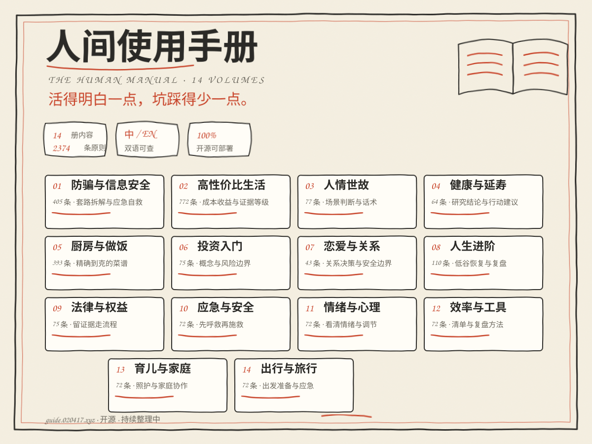
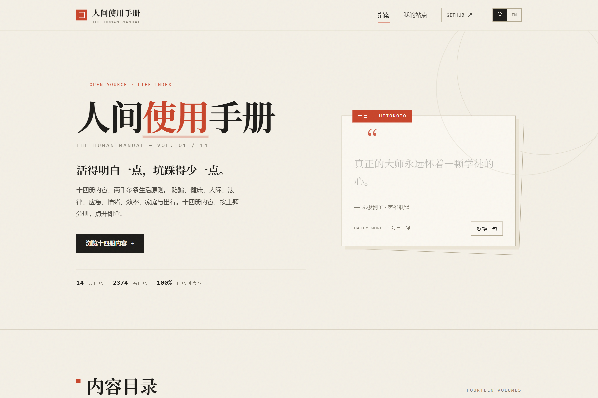
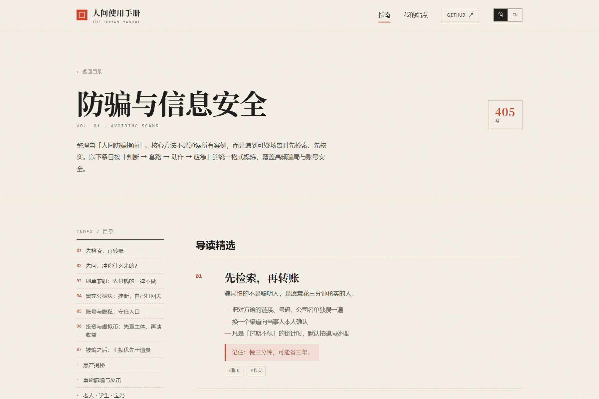
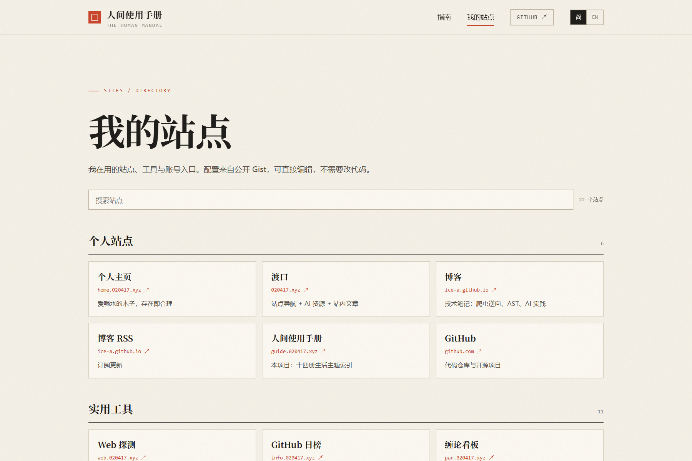
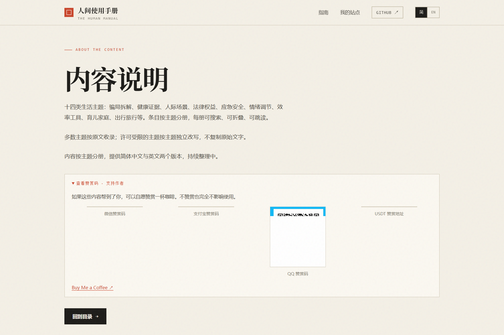
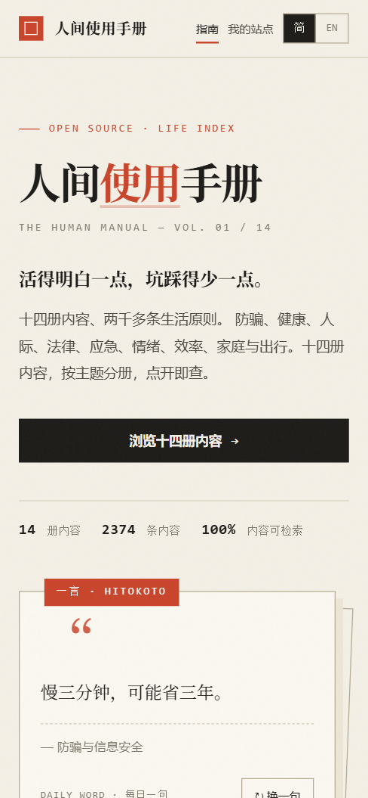

# 人间使用手册 · THE HUMAN MANUAL

> 活得明白一点，坑踩得少一点。



把十四类生活主题整理成一份格式统一、随时可查的内容集合。当前收录 **14 册、2374 条**，简体中文与英文双语。纯静态站点，可部署到 Vercel、Cloudflare Pages、GitHub Pages 或任意静态托管。

- 在线站点：<https://guide.020417.xyz/>
- 源码仓库：<https://github.com/ice-a/human-manual>

## 页面预览

| 首页 | 指南页 |
| --- | --- |
|  |  |

| 我的站点 | 关于与赞赏 |
| --- | --- |
|  |  |



## 站点结构

- **首页**：内容主题目录、使用方式、Issue 反馈区块（从 GitHub Gist 读取配置），以及「一言」组件；底部有「内容说明」入口。
- **指南页**：每册按分类列出全部条目，支持搜索与展开/收起，条目只保留文字。
- **关于页**：极简文字说明与自愿赞赏区块，仅在首页底部提供入口。
- **导航**：顶部「我的站点」打开站内 `/#/sites` 页面，集中展示你的全部站点，支持搜索与分类。

站点与反馈配置在仓库根目录 `sites.json`、`poll.json`，同步到同一个公开 Gist（`0160c8ccd7781e3c88d33ed7bcbe6dc5`）：

- 站点：`https://gist.githubusercontent.com/ice-a/0160c8ccd7781e3c88d33ed7bcbe6dc5/raw/9cb6a6f39787fd5a43ea5ff53885a18c07043224/sites.json`
- 反馈：`https://gist.githubusercontent.com/ice-a/0160c8ccd7781e3c88d33ed7bcbe6dc5/raw/4972a84123c092fa522eda09e57a05eac5f2ba23/poll.json`

直接编辑 Gist 里的 JSON 即可增删站点或改反馈文案，刷新页面生效，不用重新构建。`sites.json` 的 `groups[].items[]` 每项含 `name`、`url`、`desc`，可选 `nameEn`/`descEn`。`poll.json` 的 `issueUrl` 是新建 Issue 的地址（默认本项目 Issues/new），`formUrl` 可填金山文档收集表链接。

### 统一内容格式

导读精选固定五个字段：标题 / 核心 / 做法 / 记住 / 标签。

全量条目统一为：

```json
{ "id": "...", "title": "...", "core": "...", "body": ["..."], "tags": ["..."] }
```

按册懒加载：中文源为 `src/data/content/<slug>.zh-CN.json`，英文为 `<slug>.en.json`，条目数与章节数记录在 `manifest.json`。每条都带以「案例：」开头的具体场景。

### 已收录内容

| 册 | 来源 | 条目 | 许可 | 方式 |
| --- | --- | --- | --- | --- |
| 防骗与信息安全 | 人间防骗指南 | 405 | CC BY-NC-SA 4.0 | 全文 |
| 高性价比生活 | 高性价比人生指南 | 772 | CC BY 4.0 | 全文 |
| 人情世故 | 人情世故指南 | 77 | 自定义非商业许可 | 主题改写 |
| 健康与延寿 | 程序员延寿指南 | 64 | Unlicense | 全文 |
| 厨房与做饭 | 做饭指南 | 393 | Unlicense | 全文 |
| 投资入门 | 投资指南 | 75 | 专有内容许可 | 主题改写 |
| 恋爱与关系 | 恋爱指南 | 43 | MIT | 全文 |
| 人生进阶 | 人生进阶指南 | 110 | CC BY-NC 4.0 | 全文 |
| 法律与权益 | 本站整理 | 75 | — | 原创 |
| 应急与安全 | 本站整理 | 72 | — | 原创 |
| 情绪与心理 | 本站整理 | 72 | — | 原创 |
| 效率与工具 | 本站整理 | 72 | — | 原创 |
| 育儿与家庭 | 本站整理 | 72 | — | 原创 |
| 出行与旅行 | 本站整理 | 72 | — | 原创 |

人情世故与投资两册按主题独立改写，不复制原始文字；其余来源册按各自许可全文收录。新增六册为本站原创主题，条目只保留文字，不含外链。

### 站名与品牌

全部品牌信息集中在 `src/data/references.ts` 的 `site` 对象：

```ts
export const site = {
  name: '人间使用手册',
  en: 'THE HUMAN MANUAL',
  slogan: '活得明白一点，坑踩得少一点。',
  sub: '十四册内容、两千多条生活原则。',
  repo: 'https://github.com/ice-a/human-manual',
}
```

导航、页脚、首页标题、关于页宣言都会读取这里的值。

## 本地开发

```bash
npm install
npm run dev      # http://localhost:5173
npm run build    # 产物在 dist/
npm run preview
```

技术栈：Vite + React + TypeScript，无后端、无数据库。

`vite.config.ts` 设置了 `base: './'`，路由使用 hash（`#/guide/xxx`），因此构建产物放在任意子路径下都能直接打开。

## 内容更新

```bash
bun scripts/extract/<slug>.ts       # 从源项目重新抓取，写入 *.zh-CN.json
bun scripts/seed-rewritten.ts       # 重建人情世故 / 投资两册改写内容
bun scripts/seed-extra.ts           # 重建六个原创主题册
bun scripts/seed-extra-more.ts      # 给新增主题册补充条目
bun scripts/translate-content.ts    # 翻译成 *.en.json（带断点缓存）
bun scripts/generate-locales.ts     # 更新界面文案英文包
```

抓取脚本在 `scripts/extract/`，共用工具在 `scripts/extract/common.ts`。翻译使用免费接口，带磁盘缓存，中断后重跑可继续。

手绘总览图源文件为 `docs/images/hand-drawn-manual.svg`，改文字或配色后用浏览器打开即可查看，PNG 由它渲染生成。

## 部署

### Vercel

Fork 本仓库 → Add New → Project 导入 → Framework 选 Vite → Deploy。`vercel.json` 已写好构建参数。

### Cloudflare Pages

Fork 本仓库 → Workers & Pages → Create → Pages → Connect to Git → 构建命令 `npm run build`，输出目录 `dist`。

### GitHub Pages

Fork 本仓库 → Settings → Pages → Source 选 GitHub Actions。仓库已附带 `.github/workflows/deploy.yml`，Push 到 `main` 即自动发布。

## 线上地址与自定义域名

- 正式域名：https://guide.020417.xyz
- GitHub Pages 默认地址：https://ice-a.github.io/human-manual/

Cloudflare 里只需加一条记录，且必须选 **DNS only（灰云）**：

| 类型 | 名称 | 值 | 代理状态 |
| --- | --- | --- | --- |
| CNAME | guide | ice-a.github.io | DNS only |

根域 `020417.xyz` 不需要动。DNS 生效后在仓库 Settings → Pages 勾选 Enforce HTTPS。

## 多语言

默认简体中文，右上角可切换 English，选择保存在浏览器本地。

- 界面文案原文：`src/data/ui.ts`
- 中文内容：`src/data/content/*.zh-CN.json`
- 英文内容：`src/data/content/*.en.json`
- 界面英文包：`src/data/locales/en.json`

## 发布文章

- 通用版：`docs/文章-人间使用手册.md`
- 小红书版：`docs/文章-人间使用手册-小红书版.md`
- 配图：`docs/images/`

两篇 Markdown 都用 `raw.githubusercontent.com` 直链引用截图，可直接粘贴到知乎 / CSDN；公众号需把图片下载后逐张上传。

## 参考项目

| 指南 | 地址 |
| --- | --- |
| 人间防骗指南 | https://qerssd.github.io/HowToAvoidScams/ |
| 高性价比人生指南 | https://github.com/eternity4719/howtolivebetter |
| 人情世故指南 | https://github.com/kkk-bot/HowToGetAlong |
| 程序员延寿指南 | https://github.com/geekan/HowToLiveLonger |
| 做饭指南 | https://github.com/Anduin2017/HowToCook |
| 投资指南 | https://github.com/xuchonglang/investing-for-beginners |
| 恋爱指南 | https://github.com/shengjidaguai-china/goutoujunshi |
| 人生进阶指南 | https://github.com/byoungd/up |

本站内容是上述项目的二次整理，版权与许可归各自作者。涉及健康、法律、投资的具体决定，请以原文及专业意见为准。
